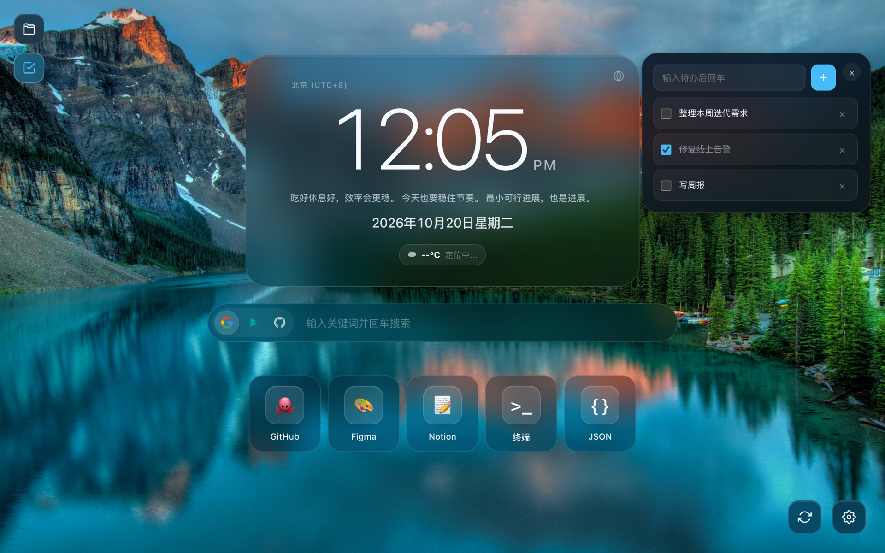
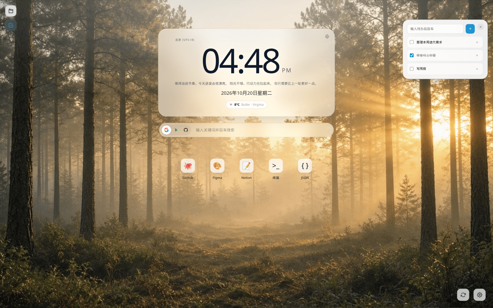
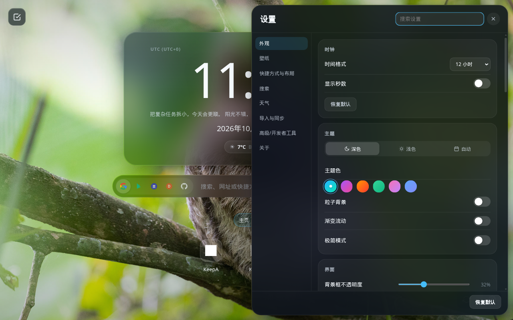

<div align="center">

# OpenTab

Chrome Manifest V3 新标签页，iPad 风格毛玻璃界面。开源、可审计。

[English](README.md) | **简体中文**

[](LICENSE)
[](https://github.com/haoyang1994/OpenTab/actions/workflows/ci.yml)
[](manifest.json)
[](manifest.json)

</div>

---

## 简介

OpenTab 覆盖 `chrome://newtab`，提供本地可定制的主页：时钟、快捷方式、搜索、天气和少量开发工具。设置只保存在本机。

## 功能

### 时钟与日历

- 毛玻璃时钟卡片，支持 12 小时 / 24 小时
- 23 个常用时区
- 可选秒数
- 带节假日和节气的日历弹层

### 主题

- 深色、浅色，或跟随系统
- 六种主题色（极光蓝、梦幻紫、日落橙、薄荷绿、樱花粉、星空蓝）
- 可选粒子背景和缓慢渐变流动
- 极简模式（双击时钟）
- 可调面板不透明度、虚化、以及快捷方式背景框

### 背景

- Bing 每日壁纸（刷新按钮可切换近期历史图）
- 预设渐变
- 三张随仓库分发的静态照片（来自 Pexels，见 [NOTICE](NOTICE)）
- 自定义图片 / 视频 URL，或本地上传

### 快捷方式

- 网站快捷链接
- 内置 SSH 终端（需要下面的本地网关）
- 本地 JSON 格式化工具和 FIX 解析器
- 文件夹（抽屉）与拖拽排序
- 工具栏弹窗可将当前标签页存为快捷方式

### 搜索、天气、待办、备份

- 搜索引擎：Google、Bing、GitHub
- 天气胶囊：浏览器地理位置 + [wttr.in](https://wttr.in)
- 侧边抽屉待办和进度条
- JSON 备份导出 / 导入，以及本地快照

## 截图

截图中的背景照片来自 [Pexels](https://www.pexels.com/license/)，**不是** Apache-2.0。署名见 [NOTICE](NOTICE)。画面里还有 Google / GitHub 标志，商标归各自所有者。

### 深色主题



### 浅色主题



### 设置面板



## 隐私说明

- 偏好设置、快捷方式、待办和快照保存在当前浏览器配置的 `chrome.storage.local`。
- OpenTab 没有统计、没有广告、没有账号登录。
- OpenTab 不会改写或拦截你打开的链接。
- 可选功能会请求少量外部主机：

| 服务 | 用途 | 数据 |
| --- | --- | --- |
| Bing 每日壁纸 API（`www.bing.com`） | 背景图 | 图片 URL / 元数据。图片版权归原作者，OpenTab 只做展示。 |
| [wttr.in](https://wttr.in) | 天气胶囊 | 浏览器地理位置权限给出的大致位置。 |
| 你添加的网站的 favicon | 快捷方式图标 | 直接向该网站请求图标。 |

SSH 连接经过你自己启动的**本地** WebSocket 网关（`ssh-gateway.mjs`），不经过 OpenTab 云服务。

## 安装

### 开发者模式加载已解压扩展（当前支持的方式）

克隆后即可直接加载，**不需要 `npm install`**。日历（flatpickr）和 SSH 终端（xterm）从仓库里的 [`vendor/`](vendor/README.md) 加载，各库的 LICENSE 文件也在对应目录中。

1. 克隆本仓库。
2. 打开 Chrome，访问 `chrome://extensions/`。
3. 打开右上角「开发者模式」。
4. 点击「加载已解压的扩展程序」，选择仓库根目录。
5. 打开新标签页。

`npm install` / `npm ci` 只在跑自动化测试，或启动本地 SSH WebSocket 网关时需要。

### Chrome 网上应用店

待发布。

## 开发

```bash
npm ci
npm run pw:install
npm test
npm run test:e2e:headed
npm run test:e2e:headless
npm run test:ci
```

`npm test` 会先跑 `tests/repo-hygiene.test.mjs`，再跑 Playwright E2E（`scripts/run-e2e.sh`）。Linux 无显示器时该脚本会用 `xvfb` 包装有头 Chromium（需安装 `xvfb` 包）。`npm run test:e2e:headed` 在有显示器时强制弹出可见浏览器。`npm run test:ci` 是同一条 E2E 脚本的兼容别名。详见 [docs/TESTING.md](docs/TESTING.md)。

修改扩展文件后，在 `chrome://extensions/` 点击扩展卡片上的「重新加载」。

## SSH 网关

SSH 终端通过本地 WebSocket 网关连接。网关**需要** Node 依赖：

```bash
npm install
npm run ssh:gateway
```

默认地址：`ws://127.0.0.1:8787/ssh`

环境变量：

- `SSH_GATEWAY_HOST` — 监听主机（默认 `127.0.0.1`）
- `SSH_GATEWAY_PORT` — 监听端口（默认 `8787`）
- `SSH_PRIVATE_KEY_PATH` — 私钥路径（默认 `~/.ssh/id_rsa`）
- `SSH_PRIVATE_KEY_PASSPHRASE` — 私钥口令（如有）

快捷方式编辑器支持 SOCKS5 代理。SSH 密码目前以明文保存在 `chrome.storage.local`，这是已知限制。

## 项目结构

```
OpenTab/
├── LICENSE / NOTICE / CHANGELOG.md
├── README.md / README.zh-CN.md
├── CONTRIBUTING.md / CODE_OF_CONDUCT.md / SECURITY.md
├── manifest.json
├── package.json
├── background.js              # Service Worker
├── home.html / home.css / home.js
├── popup.html / popup.css / popup.js
├── tool.html / tool.css / tool.js
├── fixparser.html / fixparser.js
├── ssh_terminal.html / ssh_terminal.css / ssh_terminal.js
├── ssh-gateway.mjs            # 本地 SSH WebSocket 网关
├── vendor/                    # 入库的 flatpickr / xterm（含各库 LICENSE）
├── icons/                     # PNG 图标和 SVG 源文件
├── assets/default_background/ # 随仓库分发的 Pexels 静图
├── screenshots/
├── tests/
├── docs/                      # 历史 SPEC、测试说明、发布说明
└── .github/                   # Issue/PR 模板和 CI
```

## 参与贡献

见 [CONTRIBUTING.md](CONTRIBUTING.md)。提交即视为按 Apache-2.0 授权（inbound = outbound）。不要求签署 CLA。

## 许可证

Copyright 2026 The OpenTab Authors

本项目采用 Apache License, Version 2.0，全文见 [LICENSE](LICENSE)。

第三方软件、照片、商标和其他材料列在 [NOTICE](NOTICE)。其中部分条目**不在** Apache-2.0 授权范围内。
